# arize-oauth-egress-relay

This is a sample in-cluster egress relay. With it, Arize on-prem can use OAuth 2.0 on Custom Model Endpoints in a network where outbound traffic must go through a corporate HTTP proxy that requires a username and password. It requires no Arize code changes.

> [!WARNING]
> **Unofficial sample, not supported.** This is not an Arize product and is not supported by Arize AI. It is a reference implementation provided as-is, without warranty of any kind (see [LICENSE](LICENSE)). Review, test and harden it against your own security and compliance requirements before running it in production. You are responsible for operating it. Arize may add native proxy support later, which would make this relay unnecessary.

## The problem

Arize sends every outbound call to a customer endpoint through its `externalendpoints` gateway, and that gateway always connects directly to the destination. It ignores `HTTP(S)_PROXY` and has no setting for an upstream proxy. Before calling out, app-server also does a DNS lookup on the Token URL. In a network where the only way out is the proxy, `login.microsoftonline.com` doesn't resolve, so the integration fails with `DNS resolution failed for both IPv4 and IPv6`.

## How the relay works

```mermaid
flowchart LR
    subgraph cluster["Kubernetes cluster"]
        arize["Arize (generative / app-server)"]
        gateway["externalendpoints gateway"]
        relay["auth-proxy Service and Deployment"]

        arize -->|"OAuth token request to the relay's cluster FQDN"| gateway
        gateway -->|"Direct HTTP on port 8080"| relay
    end

    proxy["Corporate HTTP proxy"]
    entra["Microsoft Entra ID (login.microsoftonline.com)"]

    relay -->|"HTTPS_PROXY: CONNECT with Proxy-Authorization: Basic"| proxy
    proxy -->|"TLS tunnel to the upstream on port 443"| entra

    classDef arizeNode fill:#eff6ff,stroke:#2563eb,color:#172554
    classDef relayNode fill:#ecfdf5,stroke:#059669,color:#064e3b
    classDef externalNode fill:#fff7ed,stroke:#ea580c,color:#7c2d12
    class arize,gateway arizeNode
    class relay relayNode
    class proxy,entra externalNode
```



The relay strips `/entra` and sends the OAuth request over TLS through the CONNECT tunnel. Responses return along the same path.

- Arize is configured with the relay's **in-cluster** URL. That name resolves through cluster DNS and the relay is reachable directly, so both the DNS pre-check and `externalendpoints` work unchanged.
- The relay removes the route prefix and forwards the request as-is to the real upstream over HTTPS. The method, body, `Authorization: Basic <client_id:secret>` header and the response all pass through unchanged. Redirects are passed through, not followed.
- Upstream traffic goes through the corporate proxy using the standard `HTTPS_PROXY` / `HTTP_PROXY` / `NO_PROXY` variables. The proxy username and password are sent as Basic auth on `CONNECT`. Nothing in the relay is specific to Azure: adding another IdP is one more entry in `ROUTES`.
- Headers and bodies are never logged, because they carry client secrets and access tokens. Credentials are redacted in the startup log.

It is built around three requirements:

| Requirement | How it is met |
|---|---|
| Only `login.microsoftonline.com` goes through the proxy | The relay only handles hosts listed in `ROUTES`. All other Arize egress is untouched. `NO_PROXY` is honoured for anything else. |
| Standard `HTTP(S)_PROXY` / `NO_PROXY`, not Azure-specific | Uses the same semantics as Go and curl (`golang.org/x/net/http/httpproxy`). Routes are generic `prefix=https://host`. |
| Basic-auth proxy | `PROXY_USERNAME` / `PROXY_PASSWORD` come from a Secret, or credentials can be embedded in the proxy URL. |

## Configuration

The administrator configures these environment variables on the relay.

| Env | Example | Notes |
|---|---|---|
| `ROUTES` | `/entra=https://login.microsoftonline.com` | Comma-separated `prefix=upstream` pairs. Longest prefix wins. |
| `HTTPS_PROXY` | `http://proxy.corp.example:8080` | Proxy used for `https://` upstreams. Lower-case names also work. |
| `HTTP_PROXY` | | Proxy used for `http://` upstreams (rarely needed). |
| `NO_PROXY` | `.svc.cluster.local,10.0.0.0/8` | Hosts, domains and CIDRs to reach directly. |
| `PROXY_USERNAME` / `PROXY_PASSWORD` | | Override any userinfo in the proxy URL. Need no URL-escaping. |
| `LISTEN_ADDR` | `:8080` | |
| `SSL_CERT_FILE` | `/etc/corp-ca/ca.crt` | Only needed if the corporate proxy does TLS inspection: the CA bundle to trust. |

## Setup (on-prem)

An administrator deploys the relay and configures Arize to allow requests to it. After that setup, the Arize integration user changes the **Token URL** in their Custom Model Endpoint and tests the integration. The URL points to the relay, which forwards requests through the corporate proxy.

### Administrator setup

You need access to the Kubernetes cluster, an internal image registry, the corporate proxy URL and credentials, and the Arize deployment's `values.yaml`. The commands below use the `arize` namespace. Substitute your namespace if it differs.

`http://` and port `8080` are accepted on-prem, since the HTTPS and port-443 rules apply only to SaaS. The hop from Arize to the relay is cluster-internal. The client secret goes to the relay in plaintext over the pod network, and from the relay to Entra over TLS. If that internal hop must be encrypted, put the relay behind your service mesh (mTLS) or terminate TLS on the relay.

1. **Build and push the image** to the internal registry:
   ```sh
   docker build -t REGISTRY/auth-proxy:0.1.0 . && docker push REGISTRY/auth-proxy:0.1.0
   ```
2. **Edit and apply** [`deploy/kubernetes.yaml`](deploy/kubernetes.yaml). Set the proxy URL and credentials in the Secret and the image name in the Deployment. Change the namespace throughout the manifest if Arize is not in `arize`. If the proxy inspects TLS, configure the corporate CA mount and `SSL_CERT_FILE` using the commented example in the manifest.
   ```sh
   kubectl apply -f deploy/kubernetes.yaml
   kubectl -n arize get svc auth-proxy -o jsonpath='{.spec.clusterIP}'
   ```
3. **Allowlist the relay in Arize `values.yaml`.** Arize's SSRF guard rejects private IPs on-prem unless they are allowlisted (`IPV4_NOT_ALLOWED_ON_PREM`), and the field accepts CIDRs. Then roll out the change:
   ```yaml
   allowedIPv4Addresses: "<clusterIP>/32"     # append to any existing entries
   # allowedIPv6Addresses: "<ipv6 clusterIP>/128"   # dual-stack clusters only
   ```
   To keep the IP stable if the Service is ever recreated, pin `spec.clusterIP` in the Service (there is a comment showing where).
4. **Check the deployment and network access.** Wait for the relay to become ready (replace `arize` if you changed the namespace):
   ```sh
   kubectl -n arize rollout status deployment/auth-proxy
   ```
   Ensure that cluster network policies allow `externalendpoints` to reach `auth-proxy:8080` and the relay to reach the corporate proxy. The supplied NetworkPolicy allows ingress only from pods labelled `app: externalendpoints`.
5. **Give the integration user the relay Token URL** shown below, adjusted for your namespace, route prefix, and tenant. Use the **fully-qualified** hostname. Arize resolves it with `dns.resolve4`, which does not apply the resolv.conf search domains.

If the model API also needs the corporate proxy, include a route such as `/llm=https://llm.example.com` in `ROUTES` when editing the ConfigMap in step 2. Also give the integration user the relayed **API Base URL**, for example `http://auth-proxy.arize.svc.cluster.local:8080/llm/v1`. Responses are streamed without buffering.

### Arize integration user setup

Complete these steps after the administrator has finished setup and provided the relay URL. You do not need Kubernetes access or the corporate proxy credentials.

1. Open your **Custom Model Endpoint** in Arize with **OAuth 2.0** authentication.
2. Set **Token URL** to the full URL provided by your administrator. For the default namespace and Entra route, it has this form:
   ```text
   http://auth-proxy.arize.svc.cluster.local:8080/entra/<tenant-id>/oauth2/v2.0/token
   ```
   Replace `<tenant-id>` with your Entra tenant ID. The URL must include the scheme, fully-qualified relay hostname, port, route prefix, and token endpoint path.
3. Keep your existing **Client ID**, **Client Secret**, and **Scope**, for example `api://<app-id>/.default`. These are your OAuth credentials. The administrator configures the separate corporate proxy credentials on the relay.
4. Keep **API Base URL** unchanged if the model endpoint is reachable directly. If your administrator also configured a model API route, use the relayed API Base URL they provide.
5. Click **Test Integration** to verify the token flow through the relay. If it fails, use the [troubleshooting table](#troubleshooting) with your administrator.

## Local demo: a real proxy with Basic auth and real Entra

[`demo/docker-compose.yaml`](demo/docker-compose.yaml) reproduces the customer's network. The relay and the "Arize" client sit on an `internal: true` Docker network with no route to the internet. Squid, with Basic auth (`svc-arize` / `Corp-Pa55!`), is the only way out.

```sh
cd demo
docker-compose up --build -d     # or: docker compose up --build -d

# Arize-style token request through the relay. With fake credentials, a JSON
# AADSTS error from Entra proves the full round trip worked.
docker-compose run --rm client -X POST -u 'client-id:secret' \
  --data 'grant_type=client_credentials&scope=api://example/.default' \
  http://auth-proxy:8080/entra/organizations/oauth2/v2.0/token
# -> {"error":"invalid_request","error_description":"AADSTS900023: ..."}  HTTP 400

# Direct egress from the same network fails:
docker-compose run --rm client --max-time 5 https://login.microsoftonline.com   # HTTP 000

# Squid shows the authenticated tunnel. CONNECT lines are written when the
# tunnel closes, so restart the relay to flush its pooled connection first.
docker-compose restart auth-proxy
docker-compose exec corp-proxy cat /var/log/squid/access.log
# ... TCP_TUNNEL/200 ... CONNECT login.microsoftonline.com:443 svc-arize ...

docker-compose down
```

With real tenant, client and scope values, the same request returns `{"token_type":"Bearer","access_token":...}`.

## Tests

```sh
go test -race ./...
```

The tests cover:
- A token request tunnelled through a fake proxy that requires Basic auth on `CONNECT`, to a TLS fake of the Entra v2 token endpoint. The request matches what Arize's `tokenClient` sends (`client_secret_basic`, form `grant_type`/`scope`).
- Wrong proxy credentials, which return 502 `upstream_unreachable`.
- IdP error responses (401 `invalid_client`) passing through unchanged.
- Choosing the proxy with `NO_PROXY`, and credential injection and redaction.
- Route parsing.

## Troubleshooting

| Symptom in Arize | Cause |
|---|---|
| `DNS resolution failed for both IPv4 and IPv6` | Token URL is not the FQDN `*.svc.cluster.local`, or still points at `login.microsoftonline.com`. |
| `IPV4_NOT_ALLOWED_ON_PREM` | The relay's ClusterIP is not in `allowedIPv4Addresses`. |
| Token request fails with 502 `upstream_unreachable` | Relay → proxy failed. Check the relay logs: `Proxy Authentication Required` means wrong credentials; a TLS error usually means TLS inspection, so set `SSL_CERT_FILE`. |
| Timeout | A NetworkPolicy is blocking `externalendpoints` → `auth-proxy:8080`, or the relay is blocked from reaching the proxy. |
| 404 `no_route` | The Token URL path doesn't start with a configured `ROUTES` prefix. |

## Long-term

This is a workaround. The real fix is for `externalendpoints` to support an upstream proxy using `HTTPS_PROXY`/`NO_PROXY` and Basic auth, configured in `values.yaml`. The DNS pre-check would also need to be skipped or relaxed for hosts that go through the proxy. Then this relay can be removed.

## License

[MIT](LICENSE)
